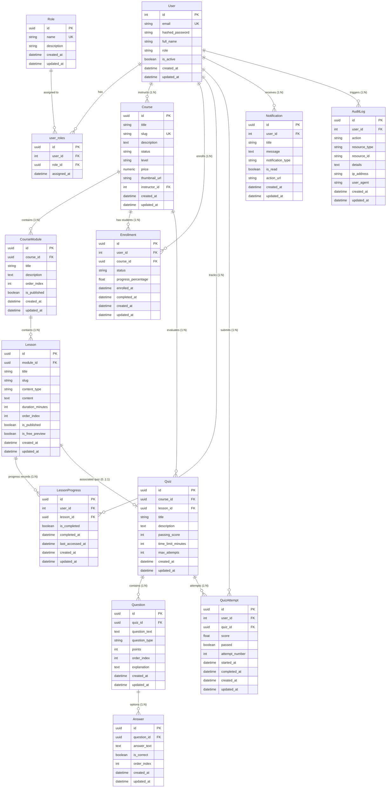

# Database Architecture & Schema Specification

This document details the relational database architecture for the Enterprise Learning Management System (LMS), implemented using **PostgreSQL**, **SQLAlchemy 2.0 (Declarative Base)**, and **Alembic** asynchronous migrations.

---

## 1. Architectural Principles

1. **ACID Relational Source of Truth**: PostgreSQL manages relational data, identity, authorization, course hierarchy, enrollments, assessments, notifications, and immutable audit trails.
2. **UUID Primary Keys**: High-volume, distributed-ready entities (`courses`, `course_modules`, `lessons`, `enrollments`, `lesson_progress`, `quizzes`, `questions`, `answers`, `quiz_attempts`, `notifications`, `audit_logs`, `roles`) utilize 36-character UUID primary keys for collision resistance and distributed scalability.
3. **Auditing & Timestamps**: All models inherit `TimestampMixin` with timezone-aware `created_at` and `updated_at` timestamps using server-default UTC time (`func.now()`).
4. **Relational Integrity & Cascades**: Foreign keys enforce strict referential integrity. Child entities (e.g., modules, lessons, questions, answers, enrollments) cascade on parent deletion (`ondelete="CASCADE"` and `cascade="all, delete-orphan"`), while audit records preserve data history by utilizing `ondelete="SET NULL"`.
5. **Declarative Order Indexing**: Hierarchical elements (Modules within Courses, Lessons within Modules, Questions within Quizzes, Answers within Questions) enforce deterministic ordering via `order_index` with compound unique constraints and database indexes.
6. **Async ORM Loading**: All SQLAlchemy model relationships are configured with `lazy="selectin"` to ensure efficient, asynchronous non-blocking pre-fetching without `MissingGreenlet` overhead.

---

## 2. Entity-Relationship Diagram



---

## 3. Detailed Entity & Table Specifications

### 3.1. `users`
Primary user identity record for authentication and RBAC authorization.

| Column | Type | Constraints | Description |
|---|---|---|---|
| `id` | `INTEGER` | `PRIMARY KEY`, `AUTOINCREMENT` | User identifier |
| `email` | `VARCHAR(255)` | `UNIQUE`, `NOT NULL`, `INDEX` | User email address (normalized lower-case) |
| `hashed_password` | `VARCHAR(255)` | `NOT NULL` | Bcrypt password hash |
| `full_name` | `VARCHAR(255)` | `NOT NULL` | User full name |
| `role` | `VARCHAR(50)` | `NOT NULL`, `DEFAULT 'STUDENT'` | Primary user role enum (`STUDENT`, `INSTRUCTOR`, `PLATFORM_ADMIN`) |
| `is_active` | `BOOLEAN` | `NOT NULL`, `DEFAULT TRUE` | Account active state |
| `created_at` | `TIMESTAMP WITH TIME ZONE` | `NOT NULL`, `DEFAULT now()` | Record creation timestamp |
| `updated_at` | `TIMESTAMP WITH TIME ZONE` | `NOT NULL`, `DEFAULT now()` | Record last updated timestamp |

### 3.2. `roles` & `user_roles`
Normalized RBAC role definition and many-to-many user-role assignment.

| Column (`roles`) | Type | Constraints | Description |
|---|---|---|---|
| `id` | `VARCHAR(36)` | `PRIMARY KEY`, `INDEX` | UUID string |
| `name` | `VARCHAR(50)` | `UNIQUE`, `NOT NULL`, `INDEX` | Role identifier (`PLATFORM_ADMIN`, `INSTRUCTOR`, `STUDENT`) |
| `description` | `VARCHAR(255)` | `NULLABLE` | Human-readable role description |
| `created_at` / `updated_at` | `TIMESTAMP WITH TIME ZONE` | `NOT NULL`, `DEFAULT now()` | Timestamps |

| Column (`user_roles`) | Type | Constraints | Description |
|---|---|---|---|
| `id` | `VARCHAR(36)` | `PRIMARY KEY` | UUID string |
| `user_id` | `INTEGER` | `FK users(id) ON DELETE CASCADE`, `INDEX` | User reference |
| `role_id` | `VARCHAR(36)` | `FK roles(id) ON DELETE CASCADE`, `INDEX` | Role reference |
| `assigned_at` | `TIMESTAMP WITH TIME ZONE` | `NOT NULL`, `DEFAULT now()` | Assignment timestamp |
| **Constraint** | `UNIQUE (user_id, role_id)` | `uq_user_role` | Prevent duplicate role assignments |

### 3.3. `courses`
Core curriculum catalog entity representing learning programs.

| Column | Type | Constraints | Description |
|---|---|---|---|
| `id` | `VARCHAR(36)` | `PRIMARY KEY`, `INDEX` | UUID string |
| `title` | `VARCHAR(255)` | `NOT NULL`, `INDEX` | Course title |
| `slug` | `VARCHAR(255)` | `UNIQUE`, `NOT NULL`, `INDEX` | URL slug |
| `description` | `TEXT` | `NULLABLE` | Extended course summary |
| `status` | `VARCHAR(50)` | `NOT NULL`, `INDEX`, `DEFAULT 'DRAFT'` | `DRAFT`, `PUBLISHED`, `ARCHIVED` |
| `level` | `VARCHAR(50)` | `NOT NULL`, `DEFAULT 'BEGINNER'` | `BEGINNER`, `INTERMEDIATE`, `ADVANCED` |
| `price` | `NUMERIC(10, 2)` | `NOT NULL`, `DEFAULT 0.00` | Course tuition price |
| `thumbnail_url` | `VARCHAR(1024)` | `NULLABLE` | Course banner/thumbnail URL |
| `instructor_id` | `INTEGER` | `FK users(id) ON DELETE CASCADE`, `INDEX` | Instructor owner reference |
| `created_at` / `updated_at` | `TIMESTAMP WITH TIME ZONE` | `NOT NULL`, `DEFAULT now()` | Timestamps |

### 3.4. `course_modules`
Sections/chapters that partition course curriculum into sequential topics.

| Column | Type | Constraints | Description |
|---|---|---|---|
| `id` | `VARCHAR(36)` | `PRIMARY KEY`, `INDEX` | UUID string |
| `course_id` | `VARCHAR(36)` | `FK courses(id) ON DELETE CASCADE`, `INDEX` | Parent course reference |
| `title` | `VARCHAR(255)` | `NOT NULL` | Module section title |
| `description` | `TEXT` | `NULLABLE` | Module description |
| `order_index` | `INTEGER` | `NOT NULL`, `INDEX`, `DEFAULT 1` | Sequential order position within course |
| `is_published` | `BOOLEAN` | `NOT NULL`, `DEFAULT TRUE` | Visibility flag |
| **Constraint** | `UNIQUE (course_id, order_index)` | `uq_course_module_order` | Unique ordering per course |

### 3.5. `lessons`
Individual units of learning content within a module.

| Column | Type | Constraints | Description |
|---|---|---|---|
| `id` | `VARCHAR(36)` | `PRIMARY KEY`, `INDEX` | UUID string |
| `module_id` | `VARCHAR(36)` | `FK course_modules(id) ON DELETE CASCADE`, `INDEX` | Parent module reference |
| `title` | `VARCHAR(255)` | `NOT NULL` | Lesson title |
| `slug` | `VARCHAR(255)` | `NOT NULL`, `INDEX` | Lesson URL slug |
| `content_type` | `VARCHAR(50)` | `NOT NULL`, `DEFAULT 'TEXT'` | `TEXT`, `VIDEO`, `QUIZ`, `DOCUMENT` |
| `content` | `TEXT` | `NULLABLE` | Formatted markdown/content payload |
| `duration_minutes` | `INTEGER` | `NOT NULL`, `DEFAULT 0` | Estimated completion duration |
| `order_index` | `INTEGER` | `NOT NULL`, `INDEX`, `DEFAULT 1` | Sequential order within module |
| `is_published` | `BOOLEAN` | `NOT NULL`, `DEFAULT TRUE` | Publishing status |
| `is_free_preview` | `BOOLEAN` | `NOT NULL`, `DEFAULT FALSE` | Free preview access flag |
| **Constraint** | `UNIQUE (module_id, order_index)` | `uq_module_lesson_order` | Unique ordering per module |

### 3.6. `enrollments`
Tracks student enrollment into courses.

| Column | Type | Constraints | Description |
|---|---|---|---|
| `id` | `VARCHAR(36)` | `PRIMARY KEY`, `INDEX` | UUID string |
| `user_id` | `INTEGER` | `FK users(id) ON DELETE CASCADE`, `INDEX` | Enrolled student reference |
| `course_id` | `VARCHAR(36)` | `FK courses(id) ON DELETE CASCADE`, `INDEX` | Target course reference |
| `status` | `VARCHAR(50)` | `NOT NULL`, `INDEX`, `DEFAULT 'ACTIVE'` | `ACTIVE`, `COMPLETED`, `CANCELLED`, `SUSPENDED` |
| `progress_percentage` | `FLOAT` | `NOT NULL`, `DEFAULT 0.0` | Computed completion percentage (0-100) |
| `enrolled_at` | `TIMESTAMP WITH TIME ZONE` | `NOT NULL`, `DEFAULT now()` | Enrollment timestamp |
| `completed_at` | `TIMESTAMP WITH TIME ZONE` | `NULLABLE` | Course completion timestamp |
| **Constraint** | `UNIQUE (user_id, course_id)` | `uq_user_course_enrollment` | Single active enrollment per student/course |

### 3.7. `lesson_progress`
Tracks granular student progress per lesson.

| Column | Type | Constraints | Description |
|---|---|---|---|
| `id` | `VARCHAR(36)` | `PRIMARY KEY`, `INDEX` | UUID string |
| `user_id` | `INTEGER` | `FK users(id) ON DELETE CASCADE`, `INDEX` | Student reference |
| `lesson_id` | `VARCHAR(36)` | `FK lessons(id) ON DELETE CASCADE`, `INDEX` | Lesson reference |
| `is_completed` | `BOOLEAN` | `NOT NULL`, `DEFAULT FALSE` | Lesson completion flag |
| `completed_at` | `TIMESTAMP WITH TIME ZONE` | `NULLABLE` | Completion timestamp |
| `last_accessed_at` | `TIMESTAMP WITH TIME ZONE` | `NOT NULL`, `DEFAULT now()` | Last engagement timestamp |
| **Constraint** | `UNIQUE (user_id, lesson_id)` | `uq_user_lesson_progress` | Single progress record per student/lesson |

### 3.8. `quizzes`, `questions`, `answers`, `quiz_attempts`
Assessment engine for evaluating comprehension.

- **`quizzes`**: Linked to `courses` and optionally `lessons` (`ondelete="SET NULL"`). Includes `passing_score` (percentage), `time_limit_minutes`, and `max_attempts`.
- **`questions`**: Linked to `quizzes` (`ondelete="CASCADE"`). Supports `MULTIPLE_CHOICE`, `SINGLE_CHOICE`, `TRUE_FALSE`, `points`, `order_index`, and `explanation`.
- **`answers`**: Linked to `questions` (`ondelete="CASCADE"`). Contains `answer_text`, `is_correct`, and `order_index`.
- **`quiz_attempts`**: Linked to `users` and `quizzes` (`ondelete="CASCADE"`). Stores `score`, `passed`, `attempt_number`, `started_at`, and `completed_at`.

### 3.9. `notifications` & `audit_logs`
- **`notifications`**: Targeted user notifications with `notification_type` (`SYSTEM`, `COURSE`, `ENROLLMENT`, `GRADE`), `is_read` flag, and optional `action_url`.
- **`audit_logs`**: Immutable enterprise compliance event log recording `action`, `resource_type`, `resource_id`, structured `details`, `ip_address`, and `user_agent`.

---

## 4. Alembic Migration Workflow

Database schema evolution is managed through Alembic async migrations located in `backend/alembic/versions/`.

- **Configuration**: `backend/alembic.ini` and `backend/alembic/env.py`
- **Generate Migration**:
  ```bash
  alembic revision --autogenerate -m "description_of_change"
  ```
- **Apply Migration**:
  ```bash
  alembic upgrade head
  ```

---

## 5. Seed Dataset

During non-production initialization with `SEED_DEMO_USERS=true`, the system seeds:
1. **Roles**: `PLATFORM_ADMIN`, `INSTRUCTOR`, `STUDENT`.
2. **Users**:
   - 1 Platform Admin (`admin@lms.enterprise.local`)
   - 2 Instructors (`instructor@lms.enterprise.local`, `marcus.sterling@lms.enterprise.local`)
   - 5 Students (`student@lms.enterprise.local`, `maya.lin@...`, `carlos.rodriguez@...`, `aisha.patel@...`, `liam.oconnor@...`)
3. **Courses**:
   - "Cloud Architecture & Kubernetes at Scale" (Instructor: Dr. Sarah Vance)
   - "Modern Full-Stack Engineering with FastAPI & React" (Instructor: Prof. Marcus Sterling)
   - "Data Engineering & Distributed Systems" (Instructor: Dr. Sarah Vance)
4. **Curriculum**: Sample modules, lessons, and comprehensive quizzes with validated questions and answers.
