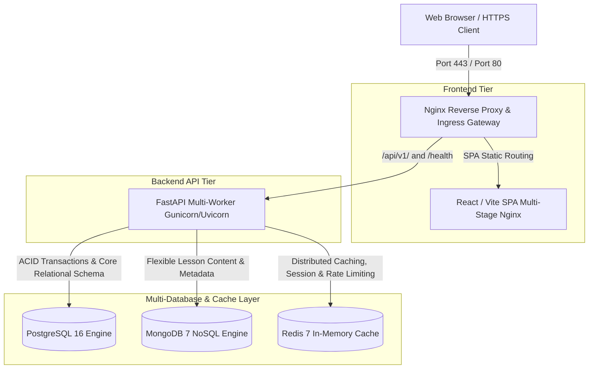

# Enterprise LMS - Production Deployment & Operations Runbook

This document provides complete instructions for deploying, configuring, securing, and maintaining the Enterprise Learning Management System (LMS) in production environments.

---

## 1. Production Architecture Overview

The Enterprise LMS follows a multi-tier, microservice-ready architecture orchestrated with Docker Compose:



---

## 2. Infrastructure Components & Port Map

| Container Name | Service | Internal Port | Host Port | Role |
| :--- | :--- | :--- | :--- | :--- |
| `lms_prod_gateway` | Nginx Ingress | 80, 443 | 80, 443 | SSL/TLS termination, rate limiting, request ID injection, reverse proxy |
| `lms_prod_frontend`| React 18 SPA | 80 | - | Static bundle distribution & client-side routing |
| `lms_prod_backend` | FastAPI Core | 8000 | - | Domain-driven REST API engine, auto-grading, certification |
| `lms_prod_postgres`| PostgreSQL 16 | 5432 | - | Users, RBAC, Courses, Modules, Lessons, Enrollments, Progress, Assessments |
| `lms_prod_mongodb` | MongoDB 7 | 27017 | - | Rich text, video stream metadata, PDF document assets, transcripts |
| `lms_prod_redis`   | Redis 7 | 6379 | - | High-speed response caching, rate limiting sliding window, cache invalidation |

---

## 3. Production Deployment Guide

### Prerequisites
- Docker Engine 24.0+ and Docker Compose v2.20+
- Valid domain name with DNS `A` records pointing to your server IP
- SSL Certificate and Private Key (Let's Encrypt or custom CA)

### Step 1: Clone Repository & Configure Environment
```bash
git clone https://github.com/enterprise/enterprise-lms.git
cd enterprise-lms

# Copy production environment configuration template
cp .env.production .env

# Generate cryptographically strong JWT secret key
openssl rand -hex 32
# Update SECRET_KEY, POSTGRES_PASSWORD, MONGO_INITDB_ROOT_PASSWORD, and REDIS_PASSWORD in .env
```

### Step 2: SSL/TLS Certificate Setup
Place your SSL certificate files in `infra/ssl/live/`:
```bash
mkdir -p infra/ssl/live
cp /etc/letsencrypt/live/yourdomain.com/fullchain.pem infra/ssl/live/fullchain.pem
cp /etc/letsencrypt/live/yourdomain.com/privkey.pem infra/ssl/live/privkey.pem
```

### Step 3: Launch Production Cluster
```bash
# Build and start all 6 services in detached mode
docker compose -f docker-compose.prod.yml up -d --build

# Verify all services are healthy
docker compose -f docker-compose.prod.yml ps
```

### Step 4: Validate Health Probes
```bash
curl -i http://localhost/health
```
Expected output:
```json
{
  "status": "healthy",
  "app_name": "Enterprise Learning Management System",
  "environment": "production",
  "version": "0.1.0",
  "subsystems": {
    "postgresql": "connected",
    "mongodb": "connected",
    "redis": "connected"
  }
}
```

---

## 4. Security & Hardening Highlights

1. **Unprivileged Container Execution:**
   - Backend runs as system user `appuser` (UID 10001).
   - Frontend runs under Nginx non-root worker process.
2. **Reverse Proxy Rate Limiting:**
   - Auth endpoints (`/api/v1/auth/`): 5 requests/sec with burst buffer of 10.
   - General API endpoints (`/api/`): 30 requests/sec with burst buffer of 20.
3. **Application Level Sliding-Window Rate Limiter:**
   - Middleware enforces 120 req/min limit per IP with Redis counter expiration.
4. **OWASP Security Headers:**
   - `X-Frame-Options: DENY`
   - `X-Content-Type-Options: nosniff`
   - `Referrer-Policy: strict-origin-when-cross-origin`
   - `Permissions-Policy: camera=(), microphone=(), geolocation=()`
   - `Strict-Transport-Security: max-age=63072000; includeSubDomains; preload`
5. **CORS Isolation:**
   - Strict origin allowlist configured via `CORS_ORIGINS`.

---

## 5. Automated Database Backups & Disaster Recovery

### Automated Backup Execution
Run manually or configure as a daily cron job (`crontab -e`):

**Linux / macOS:**
```bash
# Execute backup script
chmod +x infra/scripts/backup.sh
./infra/scripts/backup.sh

# Recommended Cron (daily at 2:00 AM)
0 2 * * * /path/to/enterprise-lms/infra/scripts/backup.sh >> /var/log/lms_backup.log 2>&1
```

**Windows (PowerShell):**
```powershell
.\infra\scripts\backup.ps1 -BackupDir "./backups"
```

### Disaster Recovery & Point-in-Time Restore

**Linux / macOS:**
```bash
chmod +x infra/scripts/restore.sh
./infra/scripts/restore.sh ./backups/20260912_120000
```

**Windows (PowerShell):**
```powershell
.\infra\scripts\restore.ps1 -BackupDir "./backups/20260912_120000"
```

---

## 6. Monitoring, Logging & Observability

- **Structured JSON Access Logs:** All Nginx and Backend access logs are formatted in JSON for integration with Datadog, Prometheus, Grafana Loki, or AWS CloudWatch.
- **Request Tracing:** The `X-Request-ID` HTTP header is injected at the Nginx edge and carried through FastAPI controllers and response headers.
- **Cache Invalidation:** Redis keys are automatically pruned on course edits, lesson updates, or curriculum modifications to guarantee zero stale data.
