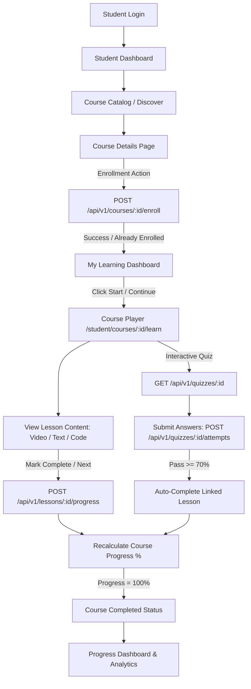

# Phase 5: Student Learning Flow & Course Player Architecture

## Overview

Phase 5 delivers the complete, authoritative student learning lifecycle in the Enterprise Learning Management System (LMS). It encompasses course discovery, student self-enrollment, interactive course consumption with rich media player, granular lesson progress tracking, server-evaluated quizzes with automatic lesson completion, and real-time completion analytics.

---

## 1. Student Journey Architecture

---

## 2. Backend Architecture & REST APIs

### 2.1 API Endpoints Summary

| Method | Endpoint | Authorization | Description |
| :--- | :--- | :--- | :--- |
| `GET` | `/api/v1/courses` | Public / Student / All | Search, filter, and paginate published courses. |
| `GET` | `/api/v1/courses/{course_id}` | Public / Student / All | Detailed course overview with public syllabus. |
| `POST` | `/api/v1/courses/{course_id}/enroll` | Authenticated (`STUDENT`, `PLATFORM_ADMIN`) | Enroll student into a published course. Prevents duplicate enrollments idempotently. |
| `GET` | `/api/v1/courses/{course_id}/player` | Authenticated Enrolled / Admin / Owner | Returns complete syllabus with module/lesson progress state, quiz links, and active enrollment. |
| `GET` | `/api/v1/me/enrollments` | Authenticated (`STUDENT`, `PLATFORM_ADMIN`) | Returns student's active enrollments, course metadata, and calculated progress percentages. |
| `GET` | `/api/v1/me/progress` | Authenticated (`STUDENT`, `PLATFORM_ADMIN`) | Aggregated learning metrics, recent activity timeline, and course-by-course breakdown. |
| `POST` | `/api/v1/lessons/{lesson_id}/progress` | Authenticated Enrolled / Admin | Upserts lesson completion status and watch time. Authoritatively recalculates parent course progress percentage. |
| `GET` | `/api/v1/quizzes/{quiz_id}` | Authenticated Enrolled / Admin | Fetches sanitized quiz structure. Answers are scrubbed of `is_correct` markers. |
| `POST` | `/api/v1/quizzes/{quiz_id}/attempts` | Authenticated Enrolled / Admin | Authoritative server-side quiz grading. Automatically marks associated lesson complete if passing grade is met. |
| `GET` | `/api/v1/quizzes/{quiz_id}/results` | Authenticated Enrolled / Admin | Historical attempts, scores, and pass/fail states for the student. |

---

## 3. Key Design Decisions & Security

### 3.1 Authoritative Server-Side Scoring (Zero Trust Frontend)
- When a student fetches a quiz via `GET /api/v1/quizzes/{quiz_id}`, the backend returns a sanitized schema where answer choices do **not** include the `is_correct` boolean.
- The student submits an attempt containing their selected answer IDs via `POST /api/v1/quizzes/{quiz_id}/attempts`.
- The backend evaluates correctness by checking the authoritative database answer keys, calculates percentage `(correct / total) * 100`, compares against `passing_score` (default 70%), and records a persistent `QuizAttempt`.
- If `score >= passing_score`, the backend triggers `ProgressService.update_lesson_progress(lesson_id, is_completed=True)` automatically.

### 3.2 Idempotent Progress Calculation
- When any lesson is marked completed or updated:
  $$\text{Progress \%} = \text{round}\left(\frac{\text{Completed Published Lessons}}{\text{Total Published Lessons in Course}} \times 100\right)$$
- If progress reaches 100%, `Enrollment.status` is updated to `COMPLETED` with `completed_at = utcnow()`.
- Re-marking an already completed lesson preserves the existing completion timestamp and does not produce duplicate database records.

### 3.3 Strict RBAC & Resource Ownership
- Students can only view their own enrollments, progress, and quiz attempts (`student_id == current_user.id`).
- Course player endpoint (`/api/v1/courses/{course_id}/player`) strictly verifies active enrollment unless accessed by the course instructor owner or platform administrator.
- Unpublished / Draft courses cannot be enrolled in or played by standard students.

---

## 4. Frontend Components & Pages

1. **`CoursePlayerPage.tsx` (`/student/courses/:courseId/learn`)**
   - Full-width immersive dark learning layout.
   - Expandable / collapsible curriculum accordion with progress checkmarks.
   - Dynamic lesson content viewer (Video player, Markdown/Text reader, interactive Quiz Runner).
   - Sequential "Previous Lesson" and "Next Lesson" navigation buttons.
   - "Mark as Complete" manual toggle with optimistic mutation state.
   - Live overall progress bar in the top navigation header.

2. **`MyLearningPage.tsx` (`/student/my-learning`)**
   - Filter tabs: "All Courses", "In Progress", "Completed".
   - Search bar across enrolled courses.
   - Progress gauge, total lessons count, and instant "Continue Learning" button.

3. **`ProgressDashboardPage.tsx` (`/student/progress`)**
   - High-level KPIs: Total Enrolled, Completed Courses, In Progress Courses, Overall Average Completion Rate.
   - Course-by-course progress breakdown with visual progress meters.
   - Recent activity timeline showing recently completed lessons and timestamps.

4. **`StudentDashboard.tsx` (`/student/dashboard`)**
   - Summary statistics cards.
   - "Continue Learning" hero card linking directly to the student's most recently active course player.
   - Quick course catalog discovery widget.

5. **`CourseDetailsPage.tsx` (`/courses/:id`)**
   - Live enrollment mutation.
   - Disables enrollment and transforms button into "Go to Course Player" if student is already enrolled.
