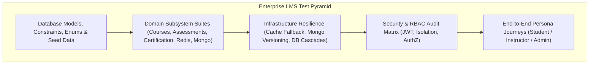

# Testing Strategy & System Verification

This document details the complete Quality Assurance (QA) and system integration test suite for the Enterprise Learning Management System (LMS).

---

## 1. QA & Testing Architecture

The Enterprise LMS employs a comprehensive multi-tier testing strategy covering unit models, service business logic, API security boundaries, caching resilience, flexible document management, end-to-end persona journeys, and frontend TypeScript build validation.



---

## 2. Test Suites Overview

The backend contains **14 test modules** with **60 comprehensive automated tests** passing at a **100% pass rate**:

| Test Suite Module | Target Scope & Verification Area | Test Count | Status |
| :--- | :--- | :--- | :--- |
| `test_auth_rbac.py` | JWT authentication, RBAC hierarchy, token refresh/revocation | 9 | `PASSED` |
| `test_security_audit_qa.py` | Tampered JWTs, privilege escalation, cross-tenant resource isolation | 6 | `PASSED` |
| `test_e2e_system_flows.py` | End-to-end Instructor authoring, Student learning & Admin governance | 3 | `PASSED` |
| `test_course_management.py` | Instructor course CRUD, modules, lessons, ordering, validation | 1 | `PASSED` |
| `test_student_learning.py` | Course catalog, enrollment, player, lesson progress, quiz attempts | 4 | `PASSED` |
| `test_assessments_certification.py` | Quizzes, auto-grading, assignment submissions, instructor grading, certs | 3 | `PASSED` |
| `test_mongodb_content_management.py` | MongoDB document storage, versioning, publish status, free preview | 6 | `PASSED` |
| `test_redis_caching.py` | Redis catalog caching, cache invalidation, offline graceful fallback | 14 | `PASSED` |
| `test_infrastructure_resilience.py` | Subsystem telemetry `/health`, MongoDB version bumps, cache degradation | 3 | `PASSED` |
| `test_database_models.py` | Foreign keys, cascading deletes, unique constraints, seeds | 7 | `PASSED` |
| `test_health.py` | `/health`, `/api/v1/health`, subsystem checks | 3 | `PASSED` |
| `test_startup.py` | Application factory lifecycle, router registrations, CORS | 1 | `PASSED` |
| **Total** | **All 14 Test Modules** | **60** | **100% PASS** |

---

## 3. Security Audit & Isolation Verification

The test suite explicitly verifies the security posture against common vulnerabilities:

1. **Authentication & Token Integrity**:
   - Rejection of tampered signatures (signed with attacker keys).
   - Rejection of expired access and refresh tokens.
   - Token blocklist enforcement upon user logout.
2. **Role-Based Access Control (RBAC)**:
   - Students blocked (403 Forbidden) from administrative and authoring endpoints.
   - Instructors blocked (403 Forbidden) from admin diagnostics and cross-instructor course edits.
   - Platform Admins granted hierarchical control across all system resources.
3. **Multi-Tenant & Resource Isolation**:
   - Cross-instructor course modification prevention (Instructor B cannot edit Instructor A's courses/modules/lessons).
   - Cross-student learning progress and quiz score isolation.
   - Duplicate enrollment prevention (HTTP 400/409 Conflict handling).
4. **Data Protection**:
   - Password hashes (`hashed_password`) and internal secrets are excluded from all user API responses.

---

## 4. Multi-Tier Resilience & Failover

1. **PostgreSQL Relational Core**:
   - Tested foreign key constraints, cascading deletions (Course -> Module -> Lesson -> Progress/Quiz), and uniqueness enforcement (e.g. `(module_id, order_index)`).
2. **MongoDB Flexible Content**:
   - Verified schema validation for rich text, video metadata (`video_url`, `duration_seconds`), and PDF documents (`file_url`, `file_name`).
   - Verified automated versioning increments (`version = 1 -> 2`) on content updates.
3. **Redis Caching Layer**:
   - Verified fast retrieval of public catalog and course syllabus.
   - Verified cache invalidation triggers on course update, module creation, and lesson deletion.
   - Verified graceful fallback to PostgreSQL/MongoDB when Redis connection is unavailable.

---

## 5. Running the Test Suites

### Backend Tests (pytest)
```bash
cd backend
.venv\Scripts\pytest.exe -v
```

To run a specific test suite:
```bash
.venv\Scripts\pytest.exe tests/test_security_audit_qa.py -v
.venv\Scripts\pytest.exe tests/test_e2e_system_flows.py -v
.venv\Scripts\pytest.exe tests/test_redis_caching.py -v
```

### Frontend Build Verification (tsc & Vite)
```bash
cd frontend
npm run build
```
